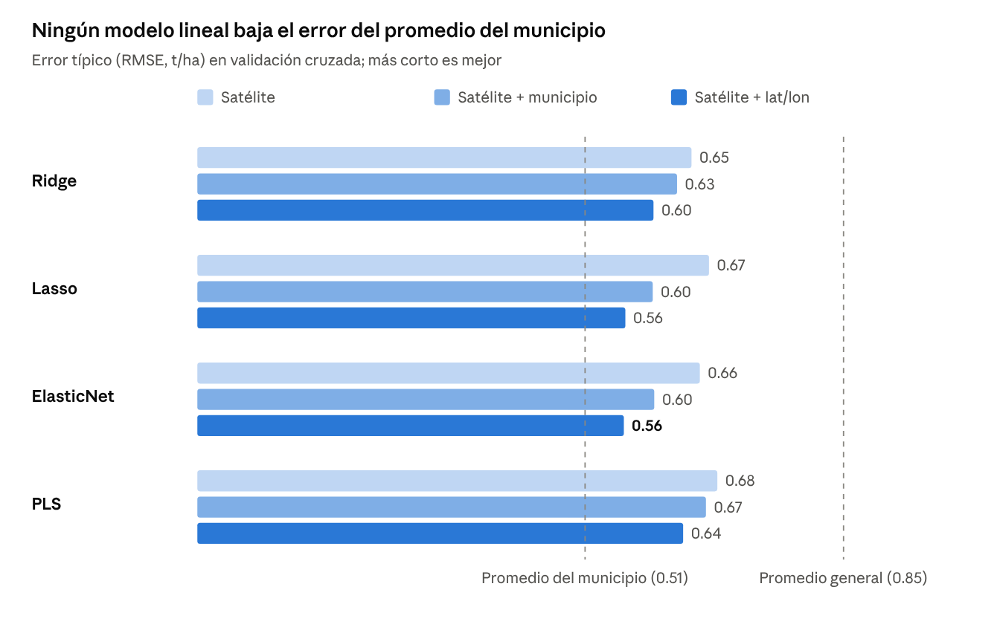
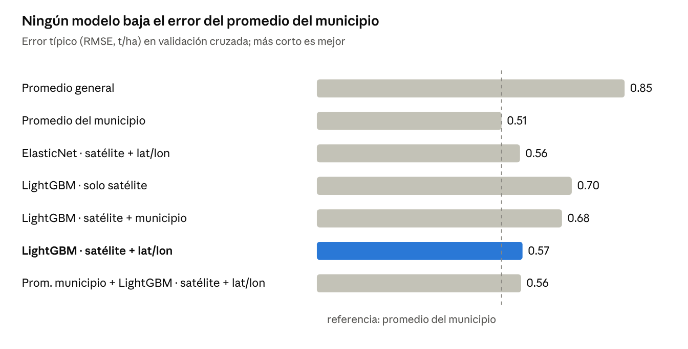

# Modelos Basados en Árboles (XGBoost y LightGBM)

### 1. Descripción Teórica y Fundamentos

**XGBoost (eXtreme Gradient Boosting)** y **LightGBM** son algoritmos de aprendizaje automático basados en la técnica de *Gradient Boosting*. En lugar de depender de un único modelo matemático complejo, estos métodos construyen un "ensamble" (conjunto) de cientos de árboles de decisión pequeños de forma secuencial. La clave de su éxito radica en que cada nuevo árbol se diseña específicamente para corregir los errores residuales del árbol inmediatamente anterior.

* **XGBoost:** Utiliza derivadas matemáticas de segundo orden para optimizar la dirección del aprendizaje y cuenta con mecanismos internos de regularización (L1 y L2) para evitar que el modelo memorice los datos (*overfitting*).
* **LightGBM:** A diferencia de los árboles tradicionales que crecen por niveles, LightGBM crece por hojas (*leaf-wise*), lo que le permite capturar patrones más complejos y ejecutarse con mayor rapidez y eficiencia de memoria.

### 2. Factibilidad y Alineación con el Reto AgroCebada 2026

**Factibilidad: Alta.** Son el estándar de la industria para datos tabulares no lineales.

* **Manejo de anomalías:** Son sumamente robustos ante datos faltantes o ruido (por ejemplo, vacíos causados por nubosidad en las imágenes satelitales).
* **Alineación con los criterios de evaluación:** La principal ventaja para este reto es que poseen un atributo nativo de **Importancia de Variables (Feature Importance)**. Esto permite extraer directamente la influencia porcentual de cada métrica, respondiendo a la perfección las preguntas guía del jurado: *"¿Qué índice es más importante en la predicción?"* y *"¿Qué variable climática tiene mayor peso?"*.


### 3. Estrategia de Implementación con el Dataset del Proyecto

Dado que el archivo `Conjunto_datos_BASICO_AgroCebada2026.csv` contiene series temporales (múltiples fechas por parcela), el modelo requiere un preprocesamiento previo de "aplanamiento".

**Paso a paso de implementación:**

1. **Feature Engineering (Ingeniería de Características):** Agrupar el dataset por `ID_POLIGONO` y extraer estadísticas descriptivas del ciclo de cultivo. Por ejemplo: `NDVI_max`, `Temperatura_mean`, `Precipitacion_sum`.
2. **Cruce de datos:** Unir estas nuevas columnas con la variable objetivo `RENDIMIENTO_T_HA` de las parcelas de entrenamiento (70% de las 197 parcelas).


3. **Entrenamiento y Extracción de Importancia (Ejemplo en Python):**

```python
import xgboost as xgb

# Configuración del modelo (controlando la profundidad para evitar sobreajuste)
modelo_xgb = xgb.XGBRegressor(max_depth=3, learning_rate=0.05, n_estimators=100)
modelo_xgb.fit(X_train, y_train)

# Obtener la importancia de las variables para justificar el modelo en el reporte
importancia_variables = modelo_xgb.feature_importances_

```

# Regresión por Procesos Gaussianos (GPR)

### 1. Descripción Teórica y Fundamentos

La **Regresión por Procesos Gaussianos (Gaussian Process Regression - GPR)** es un modelo probabilístico, no paramétrico y basado en el teorema de Bayes. A diferencia de los modelos tradicionales que buscan encontrar "la fórmula matemática única" que mejor se ajuste a los datos, el GPR considera una distribución sobre *todas* las funciones posibles que podrían explicar los datos.

Funciona a través de una "Función Kernel" (como la Función de Base Radial - RBF). El Kernel evalúa la similitud entre las parcelas; la premisa es empírica: si la parcela A tiene condiciones satelitales y climáticas muy similares a la parcela B, entonces sus rendimientos agrícolas estarán altamente correlacionados.

### 2. Factibilidad y Alineación con el Reto AgroCebada 2026

**Factibilidad: Muy Alta (Especialmente estratégico para el modelo de negocio de FIRA).**

* **Eficacia en Datasets Pequeños:** El GPR tiene un desempeño excepcional en conjuntos de datos reducidos. Dado que el volumen de entrenamiento está limitado a aproximadamente 138 parcelas, algoritmos masivos como redes neuronales fallarían, mientras que el GPR extraerá el máximo valor de los datos disponibles.


* **Estimación de Incertidumbre y Política Pública:** Esta es su ventaja competitiva para el reto. El GPR no solo predice un valor fijo, sino que entrega una **distribución de probabilidad (Media y Desviación Estándar)**. Esto se vincula directamente con la sección requerida sobre *"Uso de la ciencia de datos en la inclusión financiera del sector agro"* y la evaluación de riesgos. Permite concluir en el reporte que: *“Parcelas con menor incertidumbre productiva representan un menor riesgo de impago, facilitando la viabilidad de créditos y reduciendo tasas de interés”*.


### 3. Estrategia de Implementación con el Dataset del Proyecto

A diferencia de los árboles de decisión, el GPR es sumamente sensible a la magnitud de los datos (las diferencias de escala entre la precipitación en mm y el NDVI que va de 0 a 1).

**Paso a paso de implementación:**

1. **Reducción de Dimensionalidad:** Dado que el GPR es complejo computacionalmente y no filtra el ruido automáticamente, se recomienda alimentarlo **solo** con el top de variables más importantes (previamente identificadas mediante un análisis de correlación o usando el Feature Importance de XGBoost).
2. **Escalado de Datos:** Es obligatorio estandarizar los datos (media 0, varianza 1) usando herramientas como `StandardScaler`.
3. **Entrenamiento y Predicción Probabilística (Ejemplo en Python):**

```python
from sklearn.gaussian_process import GaussianProcessRegressor
from sklearn.gaussian_process.kernels import RBF, WhiteKernel
from sklearn.preprocessing import StandardScaler

# 1. Escalar los datos (Crucial para GPR)
scaler = StandardScaler()
X_train_scaled = scaler.fit_transform(X_train)
X_test_scaled = scaler.transform(X_test)

# 2. Definir el Kernel (Similitud base + Manejo de ruido blanco)
kernel = 1.0 * RBF(length_scale=1.0) + WhiteKernel(noise_level=1)
modelo_gpr = GaussianProcessRegressor(kernel=kernel, n_restarts_optimizer=10)
modelo_gpr.fit(X_train_scaled, y_train)

# 3. Predicción con medición de Incertidumbre
# Al poner return_std=True obtenemos la estimación y el riesgo asociado
predicciones_rendimiento, incertidumbre = modelo_gpr.predict(X_test_scaled, return_std=True)

# Modelos Lineales Regularizados (Ridge, Lasso, ElasticNet) y PLS

### 1. Descripción Teórica y Fundamentos

Los cuatro son regresiones lineales adaptadas para cuando hay **muchas variables, muy parecidas entre sí, y pocos datos**. Es justo el caso del reto: 217 variables satelitales para 138 parcelas. Una regresión lineal normal, con más variables que parcelas, tiene infinitas soluciones y sus coeficientes se disparan cuando las variables se parecen (NDVI, EVI y SAVI de agosto se mueven casi juntos). Estos modelos lo evitan de dos formas: castigando los coeficientes grandes (Ridge, Lasso, ElasticNet) o resumiendo las variables en pocos componentes (PLS).

* **Ridge:** Agrega una penalización a la suma de los coeficientes al cuadrado (L2). Encoge todos los coeficientes hacia cero sin eliminar ninguno, y reparte el peso entre variables parecidas, por lo que es muy estable. Parámetro: `alpha`.
* **Lasso:** Agrega una penalización a la suma de los valores absolutos de los coeficientes (L1). Deja muchos coeficientes en cero exacto, es decir, **selecciona variables** automáticamente. De un grupo de variables muy parecidas suele quedarse con una casi al azar. Parámetro: `alpha`.
* **ElasticNet:** Combina L1 y L2. Selecciona variables como Lasso, pero conserva grupos de variables correlacionadas como Ridge. Parámetros: `alpha` y `l1_ratio` (0 = Ridge puro, 1 = Lasso puro).
* **PLS (Mínimos Cuadrados Parciales):** No castiga coeficientes; construye unos pocos **componentes** (combinaciones de las variables) elegidos para relacionarse lo más posible con el rendimiento, y hace la regresión sobre ellos. Se parece a PCA, pero PCA no mira el rendimiento y PLS sí. Es muy usado en espectroscopía e índices de vegetación. Parámetro: número de componentes.

### 2. Factibilidad y Alineación con el Reto AgroCebada 2026

**Factibilidad: Media-Alta. ElasticNet es el mejor candidato de los cuatro, pero con los datos satelitales actuales no supera a predecir el promedio del municipio de cada parcela.**

* **Eficacia en Datasets Pequeños:** Funcionan bien con 138 parcelas y no se sobreajustan tanto como los modelos de árboles.
* **Interpretabilidad:** Cada variable tiene un coeficiente con signo, lo que permite responder directamente *"¿Qué índice es más importante en la predicción?"*.
* **Limitación:** Suponen relaciones lineales; no detectan por sí solos efectos como "el NDVI alto solo ayuda si llovió".

**Resultados de la prueba con el dataset (validación cruzada, 138 parcelas):**

| Modelo | Variables | Error (t/ha) | R² | Acierto % |
|---|---|---|---|---|
| Promedio del municipio (referencia) | — | 0.51 | 0.64 | 90.4 |
| ElasticNet | Satélite + lat/lon | 0.56 | 0.56 | 88.3 |
| Lasso | Satélite + lat/lon | 0.56 | 0.56 | 88.4 |
| Ridge | Satélite + lat/lon | 0.60 | 0.50 | 87.3 |
| PLS | Satélite + lat/lon | 0.64 | 0.43 | 86.2 |

* **Por municipio:** ningún modelo supera al promedio del municipio en Chignahuapan, Calpulalpan, Singuilucan, Almoloya ni Cuautepec de Hinojosa.
* **Municipio desconocido:** si se entrena sin un municipio y se predice ese municipio completo, los cuatro fallan por alrededor de 1 t/ha (excepto Almoloya).
* **Dentro de Chignahuapan:** R² cercano a 0; el satélite no distingue parcelas buenas de malas dentro de un mismo municipio.
* **Variables con más peso:** índices de junio y de rastrojo/labranza (CRC, NDTI, STI), LAI de octubre y MSI de noviembre. Reflejan más la zona y el manejo que el vigor del cultivo.




### 3. Prompts Utilizados en la Investigación

| # | Prompt (resumen) | Qué se hizo | Resultado principal |
|---|---|---|---|
| 1 | Hacer una prueba de los datos enfocada en Ridge/Lasso/ElasticNet y PLS, explicando qué se probó, cómo y en qué municipios | Se construyeron 217 variables satelitales por parcela (jun–nov 2025) y se evaluaron los cuatro modelos con tres pruebas de validación | Ningún modelo supera al promedio del municipio (0.51 t/ha); el mejor es ElasticNet con lat/lon (0.56 t/ha) |
| 2 | Quedarse solo con los resultados de Ridge, Lasso y ElasticNet | Se filtraron y guardaron los resultados | Tablas de error por prueba y por municipio |
| 5 | Hacer el documento de Ridge, Lasso, ElasticNet y PLS | Se recalcularon las pruebas con las medidas de acierto y se redactó el documento | Esta sección |
| 7 | Probar "promedio del municipio + modelo" con todos los modelos | Cada modelo predice solo la diferencia de cada parcela contra el promedio de su municipio | Ninguno mejora al promedio solo; Lasso deja todos los coeficientes en cero |

# Prueba Práctica de LightGBM con el Dataset del Reto

### 1. Descripción Teórica y Fundamentos

LightGBM construye cientos de árboles de decisión pequeños, uno tras otro; cada árbol nuevo predice el error que dejaron los anteriores y se suma a la predicción con un peso pequeño (tasa de aprendizaje).

* **Histogramas:** agrupa cada variable en unos 255 rangos, por lo que entrena muy rápido.
* **Crecimiento por hoja (*leaf-wise*):** divide primero la rama donde más baja el error; es más preciso, pero con pocos datos tiende a memorizar.
* **Datos faltantes:** los maneja sin rellenarlos (útil con huecos por nubes).
* **Usos típicos:** datos tabulares con miles o millones de registros (ventas, riesgo crediticio, fraude, rendimiento agrícola con muchos pixeles).

### 2. Factibilidad y Alineación con el Reto AgroCebada 2026

**Factibilidad: Baja como modelo principal con los datos actuales; útil como complemento.**

| Modelo | Variables | Error (t/ha) | R² | Acierto % |
|---|---|---|---|---|
| Promedio del municipio (referencia) | — | 0.51 | 0.64 | 90.4 |
| ElasticNet (comparación) | Satélite + lat/lon | 0.56 | 0.56 | 88.3 |
| LightGBM | Solo satélite | 0.70 | 0.31 | 85.3 |
| LightGBM | Satélite + lat/lon | 0.57 | 0.55 | 88.4 |
| Promedio municipio + LightGBM | Satélite + lat/lon | 0.56 | 0.56 | 88.6 |

* **Sobreajuste:** con 138 parcelas y 217 variables no tiene suficientes ejemplos; dentro de Chignahuapan obtuvo R² de −0.46, peor que predecir el promedio.
* **Municipio desconocido:** falla por alrededor de 1 t/ha (por ejemplo, predice 4.00 t/ha para Calpulalpan, cuyo real es 3.00).
* **Importancia de variables:** la longitud pesa ocho veces más que cualquier índice satelital (0.64 contra 0.08 de ENDWI de julio); el modelo aprende sobre todo *dónde* está la parcela.
* **Cuándo sí convendría:** al agregar clima (CHIRPS, CHIRTS) y topografía (elevación, pendiente), reduciendo a 20–30 variables, o en un ensamble con ElasticNet.



### 3. Prompts Utilizados en la Investigación

| # | Prompt (resumen) | Qué se hizo | Resultado principal |
|---|---|---|---|
| 3 | Explicar qué es LightGBM, en qué se enfoca y sus usos; probarlo con los datos, analizar si es factible, porcentaje de acierto, métodos y regiones | Explicación del modelo y prueba con tres validaciones; se agregó la medida de acierto % | LightGBM acierta 88.4%, empata con ElasticNet y queda debajo del promedio del municipio (90.4%) |
| 4 | Generar un documento que explique la prueba de LightGBM | Se redactó el documento de LightGBM | Esta sección |
| 7 | Probar "promedio del municipio + modelo" con todos los modelos | LightGBM predice solo la diferencia de cada parcela contra el promedio de su municipio | Empeora el resultado: 88.6% contra 90.4% del promedio solo |

```